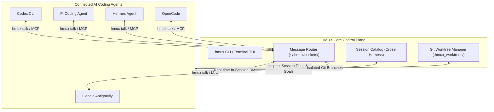

# 🤖 HMUX: Universal AI Coding Agent Harness Fleet Manager

[](LICENSE)
[](https://python.org)
[](https://modelcontextprotocol.io)
[](#-built-with-ai)

`hmux` (Harness Multiplexer) is a lightweight, zero-dependency fleet manager and real-time inter-harness communication mesh for AI coding agents (**Antigravity**, **Codex**, **OpenCode**, **Hermes**, **Pi**, **Freebuff(not tested)**,.) on a single machine.

It solves the two biggest problems in multi-agent pair programming:
1. **Concurrency Without Conflicts:** Automatic Git worktree isolation so multiple agents can code simultaneously without stepping on each other's changes.
2. **Real-Time Cross-Harness Mesh:** A peer-to-peer Unix domain socket router and Model Context Protocol (MCP) server so agents running in different terminals can find each other's sessions, message one another, and report back—**without creating new sessions or wasting tokens**.

---

## 🌟 Architecture & Features



### 1. Real-Time Inter-Harness Communication (The Mesh)
* **Direct in-session messaging:** Send instructions into an already-running agent's interactive terminal prompt via `hmux talk <session_id> "<msg>"`.
* **Loopback replies (`--wait`):** The caller blocks until the receiving harness formulates and routes its report back.
* **Fleet-wide broadcasts:** Announce changes (e.g. database rebased, schema locked) to all active terminals simultaneously with `hmux broadcast`.

### 2. Universal Session Catalog (Titles, Goals & History)
* Scans native transcript storage across all harnesses (JSONL, SQLite, brain artifacts).
* Instantly extracts conversation titles, objectives, touched files, and last turns without loading thousands of raw tokens.
* View all with `hmux sessions` or inspect a specific session with `hmux inspect <session_id>`.

### 3. Model Context Protocol (MCP) Server (`hmux mcp`)
Exposes fleet discovery and messaging tools directly into agent prompt loops:
* `list_active_harnesses()`: Find online agents and current tasks.
* `list_all_sessions()`: Explore historical sessions and goals across all harnesses.
* `talk_to_harness(target, message, wait_for_reply=True)`: Message another agent autonomously.
* `broadcast_to_harnesses(message)`: Announce updates to the fleet.

### 4. Automated Git Worktree Sandboxing
* Each spawned agent works in a dedicated worktree (`.hmux_worktrees/<task>`) on a separate branch (`agent/<task>`).
* Zero file collisions, safe diff preview (`hmux diff <id>`), and one-command merging (`hmux merge <id>`).

### 5. Native PTY Multiplexer
* Spawns agents in isolated pseudoterminals without `tmux` or Docker overhead.
* Detach anytime with `Ctrl-]` and reattach with `hmux attach <id>`.

---

## 🚀 Installation

```bash
# Clone the repository
git clone https://github.com/SynthoFunker/harness-fleet.git
cd harness-fleet

# Install in editable mode
pip install -e .
```

Verify installation:
```bash
hmux harnesses
```

---

## 📖 CLI Command Reference

### Fleet Discovery & Inspection
```bash
# List all active chatting sessions and historical sessions with titles
hmux sessions

# Show only live running sessions
hmux sessions --live-only

# Filter sessions by harness
hmux sessions --harness codex

# Deeply inspect an agent's objective, touched files, and last turn
hmux inspect codex-worker
hmux inspect pi d7e0275b
```

### In-Session Peer Messaging
```bash
# Talk to an active agent and wait for its reply
hmux talk codex-worker "Please review auth.py for race conditions" --from antigravity-main --wait

# Broadcast an announcement to all active harnesses in the fleet
hmux broadcast "Main branch rebased on master. Please pull changes."

# View inter-harness message logs and replies
hmux inbox
```

### Spawning & Attachment
```bash
# Spawn Codex in an isolated Git worktree on branch agent/jwt-fix
hmux spawn --harness codex --task jwt-fix --prompt "Implement JWT rotation"

# Attach interactively to an agent terminal (Press Ctrl-] to detach)
hmux attach codex-jwt-fix

# Run a non-interactive one-shot task with a specific model (auto-exits when complete)
hmux spawn --harness pi --model claude-3-5-sonnet --task lint-check --prompt "Run lint checks" --headless

# Inspect what the agent modified in its worktree
hmux diff codex-jwt-fix

# Merge completed branch back into main
hmux merge codex-jwt-fix
```

### Live Terminal Dashboard
```bash
hmux top
```

---

## 🔌 MCP Server Configuration

To let your AI coding agents talk to each other autonomously, add `hmux` to your agent's MCP configuration:

**Antigravity (`~/.gemini/config/mcp_config.json`)**:
```json
{
  "mcpServers": {
    "hmux": {
      "command": "hmux",
      "args": ["mcp"]
    }
  }
}
```

**Pi (`~/.pi/agent/mcp.json`)**:
```json
{
  "mcpServers": {
    "hmux": {
      "command": "hmux",
      "args": ["mcp"]
    }
  }
}
```

**Codex**:
```bash
codex mcp add hmux -- hmux mcp
```

**OpenCode V2 (`~/.config/opencode/opencode.json`)**:
```json
{
  "mcp": {
    "servers": {
      "hmux": {
        "type": "local",
        "command": ["hmux", "mcp"],
        "timeout": { "execution": 600000 }
      }
    }
  }
}
```
Use an absolute path (for example `["/home/you/.local/bin/hmux", "mcp"]`) if `hmux` is not on OpenCode's `PATH`. The longer execution timeout keeps `talk_to_harness(..., wait_for_reply=True)` alive while the remote agent works.

OpenCode V2 sessions are read directly from `~/.local/share/opencode/opencode.db`, so `hmux sessions` lists live TUIs without HMUX having spawned them. Address one by its native ID:

```bash
hmux sessions --live-only
hmux talk ses_abc123 "Please review the migration" --wait
```

Replies are extracted from the OpenCode message store after the turn completes. Native OpenCode sessions are intentionally excluded from `hmux broadcast` so a fleet-wide announcement never starts unsolicited model turns in every open TUI; sessions spawned and managed by HMUX remain broadcast targets.

---

## 🛠 Supported Harnesses

| Harness | Aliases | Execution Modes |
| :--- | :--- | :--- |
| **Google Antigravity** | `agy`, `antigravity` | Interactive, Headless, Subagents |
| **Codex** | `codex` | Interactive TUI, `exec`, `app-server` |
| **OpenCode** | `opencode`, `open-code` | Interactive, Headless (`run --format json`), V2 SQLite session store |
| **Pi Agent** | `pi` | Interactive REPL, Non-interactive (`-p`), RPC |
| **Hermes** | `hermes` | Interactive Chat, `-z`, ACP Server |
| **Freebuff** | `freebuff`, `manicode` | Interactive, `.agents` CI mode |
| **Claude Code** | `claude`, `claude-code` | Interactive, Headless (`-p`) |
| **Aider** | `aider` | Pair Programming REPL |

---

## 🤖 Built with AI

This project was developed through AI **Google Antigravity** (`agy`). Its real-time inter-harness messaging protocol was battle-tested live across concurrent sessions of Antigravity, Codex, and Hermes during development.

---

## 📄 License

Apache License 2.0. See [LICENSE](LICENSE) for details.
